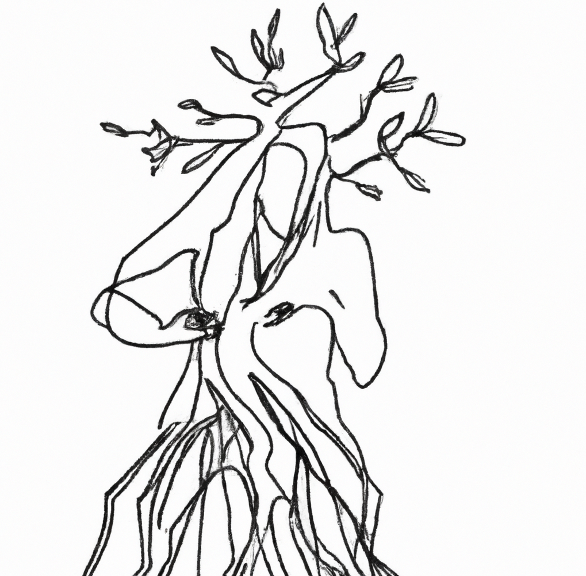

# FIONA: FInding Outliers iN Attributes



FIONA, short for "Finding Outliers in Attributes" is an innovative framework designed for the detection of categorical
outliers within datasets. This configuration-free and user-friendly tool specializes in identifying unusual patterns in
data attributes, making it invaluable for data analysis and decision-making processes. FIONA's key strengths lie in its
ability to capture syntactic structures, its deterministic nature, and its adaptability to various encodings and
languages, making it a powerful and accessible tool for outlier detection in diverse datasets.

FIONA is the Master's Thesis of Thanos Tsiamis
at Utrecht University for the program of Computing Science. It was developed under
the supervision of Dr. A.A.A. (Hakim) Qahtan for the academic year of 2022 - 2023.

## How to run

There are 2 ways to run the project: (i) [Locally](#local-execution) and (ii) in [Docker](#docker).

**We strongly advise towards the second way (Docker) due to its simplicity.**

### Local execution

**Important Note**: Make sure that Node.js 20.9+ and Python 3.11+ are installed in your system.

For the **front end**:

One-liner in a PowerShell terminal: `cd .\client_side\; npm install; npm run dev`

One-liner in a bash terminal: `cd client_side && npm install && npm run dev`

Step by step:

- Open a terminal and cd to the `client_side` folder
- Run the command `npm install`
- Run the command `npm run dev`

For the **back end**:

One-liner in a PowerShell terminal: `cd api; pip install -r requirements.txt; python main.py`

One-liner in a bash terminal: `cd api && pip install -r requirements.txt && python main.py`

Step by step:

- Open a second terminal and cd to the api folder
- Install the necessary requirements in `requirements.txt` file
- Run the command `python main.py`

### Tests

The test suite lives in `api/tests`. It needs the test-only dependencies:

```bash
cd api
pip install -r requirements-dev.txt
pytest
```

### Docker

**_Important Note_**: A docker installation is required for it to work. More info on how to
install it [here](https://docs.docker.com/get-docker/).

- Once Docker is installed, navigate to the directory where you have the FIONA project files.

- Open a terminal or command prompt.

- Run the following command to start the Docker containers: `docker compose up --build`

The Docker images run production servers (Gunicorn for the API and a production Next.js build for the client), so
rebuild them after changing the source. Use the [local execution](#local-execution) instructions for hot reloading.

The client uses `NEXT_PUBLIC_API_URL` at build time (Next.js inlines `NEXT_PUBLIC_*` variables). Set it before building if
the browser should reach the API at a different address. For example, in PowerShell:
`$env:NEXT_PUBLIC_API_URL="http://localhost:5000"; docker compose build client-service`, or in bash:
`NEXT_PUBLIC_API_URL=http://localhost:5000 docker compose build client-service`.

Uploaded files and results are stored in the `fiona-data` and `fiona-results` Docker volumes. Results older than 7 days
are pruned automatically; set `FIONA_RESULT_RETENTION_DAYS` to change that period (0 disables pruning). Set
`FIONA_LOG_LEVEL` (default `INFO`) to control the API log level.

Please make sure that approximately 2GB of storage are available for the 2 docker containers.

## How to use

After the system is up and running, head to [http://localhost:3000](http://localhost:3000) and upload the file you want
outliers to be detected in the corresponding form.

Note: Back-end resides at [http://localhost:5000](http://localhost:5000).

## Note

Development was done on Windows 10 with Firefox and Chrome.

## Contact

We're always looking to improve our project, so any input you have is greatly appreciated. If you encounter any issues
or bugs, please report them on our GitHub issues page.
